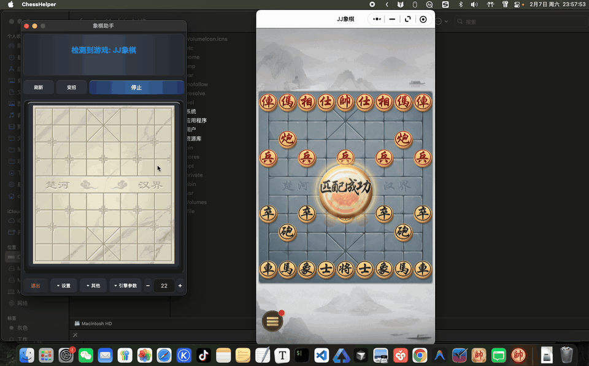
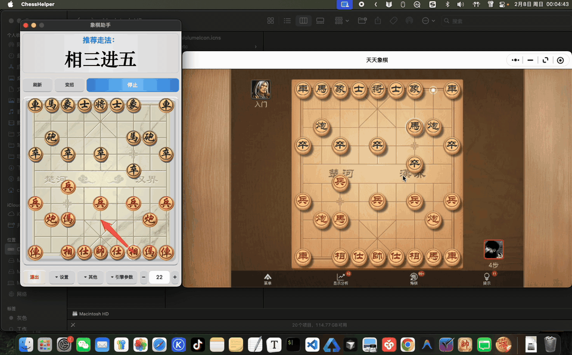

# 象棋助手 (Chess Helper)

一款智能的中国象棋辅助工具，支持微信小程序平台 **JJ象棋** 和 **天天象棋** 直接使用，无需使用改造的官方客户端，无封号风险。利用计算机视觉技术和强大的 Pikafish 象棋引擎，为您提供实时的局势分析与着法推荐。同时支持**手机端跨端协同协助**，随时随地享受高算力支招。

---

## 📸 功能演示 (Demo)

### 自动识别与实时分析
程序能够自动检测游戏窗口，精准定位棋盘，并实时显示最佳着法路线。


计算速度快，引擎参数可调。


---

## ✨ 主要功能 (Key Features)

-   **🤖 全自动平台检测**:
    -   无需手动选择，自动识别当前运行的游戏（支持 JJ象棋、天天象棋）。
    -   支持断线重连，游戏重启后自动恢复分析。

-   **🎯 动态棋盘定位**:
    -   **4K/Retina 支持**: 完美适配高分辨率屏幕，坐标识别精准。
    -   **智能跟随**: 窗口移动或缩放时，自动计算新的棋盘区域，无需人工干预。
    -   **抗干扰**: 采用霍夫圆变换与颜色过滤算法，排除背景干扰，精准锁定棋子。

-   **📱 手机端跨端协同协助**:
    -   **双端联动**: 手机端按需上传棋盘截图，电脑端后台高算力 Pikafish 秒级深度分析，分析结果与着法路线实时同步呈现在桌面端棋盘上。
    -   **一键极速配对**: 桌面端内置“手机协助”卡片与动态二维码，手机端 App 扫码即可瞬间完成配对。
    -   **Wi-Fi 直连与公网安全穿透**: 局域网内通过 Wi-Fi 直连极低延迟；外出或蜂窝网络环境下自动通过 Cloudflare 安全隧道无感穿透，随时随地可用。
    -   **实时心跳与状态感知**: 桌面端实时感知手机连接状态（🟢 Wi-Fi 直连 / 🟡 蜂窝网络 / ⚪ 已断开），内置 8 秒心跳自动保活与超时检测。
    -   **互斥保护与并发安全**: 桌面端分析主循环与手机端请求互斥守护，防止多端资源冲突。

-   **💡 强大引擎内核**:
    -   内置高性能 **Pikafish** 象棋引擎。
    -   支持 **深度优先**与**时间优先**两种分析模式。
    -   可自定义思考层数与时间限制，满足不同场景需求。

-   **🛡️ 稳健运行**:
    -   **防误触机制**: 智能识别结算画面与异常遮挡，避免错误着法推荐。
    -   **多线程架构**: 界面流畅，分析过程不卡顿。

---

## 🛠️ 安装与使用 (Installation & Usage)

### 环境要求
-   macOS 12+ (支持 Intel 与 Apple Silicon)
-   Python 3.10+

### 快速开始
-   下载安装客户端 dmg 文件即可使用。

### 手机端协同使用
1. **启动手机协助**:
   - 在桌面端主界面点击菜单栏「工具」-> 勾选「开启手机协助」（默认后台服务端口为 `5050`）。
2. **扫码配对**:
   - 点击「扫码配对」调出配对卡片，卡片会自动展示局域网 IP 直连信息及 Cloudflare 外网安全隧道地址。
   - 打开配套手机端 App 扫描二维码即可一键绑定连接。
3. **按需协助**:
   - 在手机端对局中遇到复杂局面时，在手机端触发分析上传截图，桌面端将即刻完成计算并返回推荐招法，同时桌面端棋盘实时绘制该局面与走子路线。

### 自行编译
-   若有兴趣和技术能力，可以参考 Pikafish 开源引擎文档，自行编译对应平台的引擎文件：https://github.com/official-pikafish/Pikafish
-   将编译好的引擎文件放入本项目 `app/Pikafish` 目录下
-   下载本项目，安装依赖，执行 `pip install -r requirements.txt`
-   运行 `python app/main.py` 即可使用
-   如有需要，可以使用 `pyinstaller ChessHelper.spec --noconfirm` 打包客户端

---

## 🔌 手机端 API 接口协议 (Mobile API Specification)

桌面端手机协助服务基于轻量 HTTP REST API 运行，便于移动端客户端进行网络对接：

### 1. 服务探活 `GET /api/ping`
- **说明**: 用于手机端快速检测桌面端服务是否在线。
- **返回示例**:
  ```json
  {
    "status": "ok",
    "message": "ChessHelper Server is running"
  }
  ```

### 2. 状态心跳 `POST /api/heartbeat`
- **说明**: 手机端周期性上报网络状态与延迟，桌面端据此显示连接指示灯。
- **请求体 (JSON 或 Form)**:
  ```json
  {
    "network": "wifi",    // 网络类型: "wifi" 或 "cellular"
    "latency": 35          // 往返延迟 (ms)
  }
  ```
- **返回示例**: `{"status": "ok"}`

### 3. 局势分析 `POST /api/analyze`
- **说明**: 上传棋盘截屏图片，调用后台常驻 Pikafish 引擎进行深度分析。
- **请求类型**: `multipart/form-data`
- **请求参数**:
  - `image`: 图片文件（PNG / JPEG 格式）
  - `param` (可选): JSON 字符串，自定义引擎参数，如 `{"goParam": "movetime", "movetime": 500}`
- **返回示例**:
  ```json
  {
    "success": true,
    "status": "success",
    "message": "分析成功",
    "move": "炮二平五",
    "move_code": "h2e2",
    "fen": "rnbakabnr/9/1c5c1/p1p1p1p1p/9/9/P1P1P1P1P/1C5C1/9/RNBAKABNR w - - 0 1",
    "error": ""
  }
  ```
  *(注：若桌面端正处于实时分析运行中，接口将返回 `{"status": "busy", "message": "服务端正忙"}`)*

---

## 🤝 贡献与反馈
欢迎提交 Issue 或 Pull Request 来帮助改进这个项目！

## 📄 许可证
本项目采用 MIT 许可证。仅供学习交流使用，请勿用于商业用途或破坏游戏公平性。